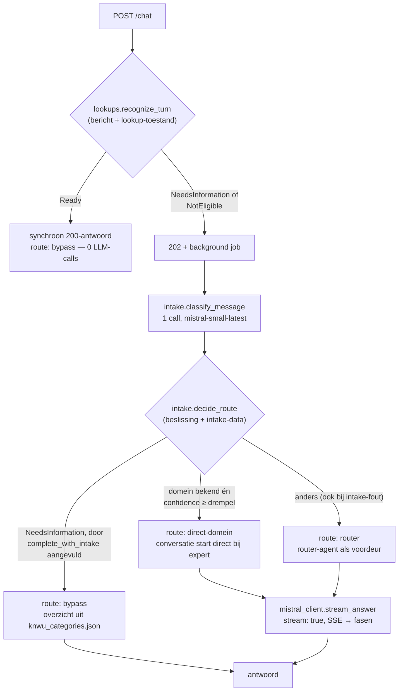

# Hoe een vraag geroute wordt

> [!WARNING]
> Deze pagina is door AI gegenereerd en nog niet door een mens gereviewd.

Elke vraag van de gebruiker krijgt in de app één van drie **routes**: `bypass`, `direct-<domein>` of `router`. Bij `bypass` beantwoordt Python de vraag deterministisch, zonder LLM-call. Bij de andere twee routes gaat het bericht naar een Mistral-agent. Dit overzicht laat zien welke route wanneer gekozen wordt, welke modellen daarbij draaien, en waar je dat in de code terugvindt — als opstap om verbeteringen aan de routing te begrijpen en te beoordelen.

Termen als *route*, *intake*, *deterministische bypass* en *fase* staan in het [GLOSSARY.md](../../GLOSSARY.md).

## De flow van een bericht

Zonder `MISTRAL_API_KEY`/`MISTRAL_AGENT_ID` draait de app in stub-mode: elk bericht krijgt synchroon een gemarkeerd stub-antwoord (handig voor offline development en tests).

## De drie routes

| Route | Wanneer | LLM-calls | Bepaald in |
| --- | --- | --- | --- |
| `bypass` | Herkende feitelijke lookup met complete invoer (geboortejaar, oude of nieuwe leeftijdscategorie), of een bestaande losse lookup zoals KNWU Licentie 17+: gecombineerd overzicht van categorie, oude indeling, verzet en licentie | 0 — Python antwoordt uit `app/knwu_categories.json`; 1 intake-call als de intake een herkende onvolledige vraag aanvult | `app/lookups.py` (`recognize_turn`, `complete_with_intake`, `render_answer`) |
| `direct-<domein>` | Intake bepaalt het domein met `confidence ≥ INTAKE_CONFIDENCE_THRESHOLD` (default 0,8) én er is een expert-id geconfigureerd voor dat domein | 1 intake-call + de expert-call | `app/intake.py` (`decide_route`), `config.EXPERT_AGENT_IDS` |
| `router` | Alles anders: vage vragen, lage confidence, geen expert-id, of een intake-fout (de fallback is altijd de router — veilig) | 1 intake-call + router-call (+ expert-call na handoff) | `app/intake.py`, `config.MISTRAL_AGENT_ID` |

De route is zichtbaar in `GET /chat/status/{job_id}` als `route` (`bypass` \| `direct-knwu` \| `router`) en in de eval (zie onder).

## Welke modellen worden gebruikt

| Model | Waarvoor | API | Config |
| --- | --- | --- | --- |
| `mistral-small-latest` | Light-model intake: één call per bericht die het bericht als JSON classificeert (intentie, domein, discipline, geboortejaar, confidence), temperature 0 | Chat Completions API | `MISTRAL_INTAKE_MODEL`, prompt in `app/prompts/intake-system.md` |
| `mistral-small-latest` | `router-agent`: alleen de voordeur, bepaalt het vraagtype en handofft | Conversations API | `scripts/architectures/huidig.json` |
| `mistral-large-latest` | De domeinexperts `knwu-agent`, `regio-agent`, `club-agent`, `archief-agent` (RAG via `document_library`, `web_search`, handoffs) | Conversations API, `stream: true` | `scripts/architectures/huidig.json` |
| geen model (Python) | `bypass`-antwoorden uit `app/knwu_categories.json` | — | `app/lookups.py` |

Alle LLM-calls zitten in de dunne laag `app/mistral_client.py`. De expert-call streamt (SSE); de events voeden de fase in `/chat/status` (`app/phases.py`). Als de stream niet start, valt de job terug op de non-streaming call (`StreamStartError`, #93). Prompt caching staat aan via `PROMPT_CACHE_KEY` (gecachte input kost 10% van de prijs). De agent-definities (model, library, websearch, handoffs per agent) zijn switchbaar via de active-pointer `scripts/architectures/active` (#95).

## Vragen die Python zelf beantwoordt (deterministische bypass)

`lookups.recognize_turn()` herkent een bericht met regex plus data uit `knwu_categories.json` en geeft een van drie beslissingen terug:

- **Ready**: de invoer is compleet en consistent. De app antwoordt synchroon met een gecombineerd overzicht van leeftijdscategorie, oude categorie-indeling, maximaal verzet en licentie. Hoofdingang is een geboortejaar (ook een kaal jaartal), een oude categorie of een nieuwe leeftijdscategorie (U, JO/MO, MU/VU). Waar geen overzicht past, blijft een losse lookup bereikbaar, zoals KNWU Licentie 17+.
- **NeedsInformation**: een herkende lookup-vraag mist de hoofdingang, bijvoorbeeld "Welk verzet?". Alleen deze beslissing mag de intake aanvullen, via `complete_with_intake()`. Die neemt alleen een geboortejaar over dat al letterlijk in het bericht staat, nooit een jaar dat uit een leeftijd is afgeleid of dat de intake verzint.
- **NotEligible**: uitleg- of uitzonderingsvragen, tegenstrijdige of onbekende invoer, meerdere renners, een expliciet wedstrijdjaar, andere disciplines dan weg en veld, en berichten die niets met de lookup te maken hebben. De intake kiest dan alleen tussen expert en router en maakt er nooit een bypass van.

Geslacht en discipline zijn optioneel: ontbreken ze, dan toont het overzicht beide. Het overzicht toont twee kandidaatseizoenen, afhankelijk van de appdatum. De exacte invoervormen, seizoensregels, overgangen en antwoordvorm staan in de [reference: categorieoverzicht](../reference/categorieoverzicht.md).

### Lookup-toestand per conversatie

De app bewaart per conversatie een lookup-toestand, los van de feedbackgeschiedenis: geen toestand, een openstaande onvolledige vraag, of een voltooid profiel met de gevalideerde invoer (geen berekende antwoorden). Een kort vervolgbericht werkt op dat profiel:

- een nieuw geboortejaar of nieuwe categorie ("en voor 2017?") vervangt de hoofdingang; geslacht en discipline blijven;
- "alleen meisjes" of "alleen veldrijden" vervangt alleen dat filter. Na "JO11" wordt dat meisjes U11; na "JO11/MO12" blijft alleen meisjes U12 over;
- een zelfstandige vraag erft niets;
- een afgewezen of inhoudelijke beurt, ook "Waarom?", beëindigt het hergebruik. Alleen een openstaande onvolledige vraag blijft staan, zodat "Welk verzet?" → "2012" het volledige overzicht geeft.

De app stelt bij elk geaccepteerd bericht synchroon de volgende toestand vast en verhoogt een revisienummer, vóór er iets wordt afgewacht. Een background job die een onvolledige vraag met de intake aanvult, publiceert zijn toestand alleen als zijn revisie nog de nieuwste is. Een oudere job kan zo een nieuwere toestand niet overschrijven of wissen; zijn eigen antwoord en status blijven ongewijzigd. Een rate-limited of ongeldig verzoek telt niet als beurt.

Het bypass-antwoord eindigt op een vooruitblikvoorbehoud en de vaste slotvraag "Moet ik de KNWU-documenten doorzoeken voor een gedetailleerder antwoord?". Een bypass start geen agentgesprek, dus een kort antwoord als "ja" komt bij de agent aan zonder de eerdere vraag; wie meer wil weten, stelt de vraag het best opnieuw. Bij B2 volgt een `Bron:`-regel met versiedatum en artikelnummers; bij B1 staat die regel niet, net als bij andere B1-antwoorden. Een bypass via de intake zet in de job de fase "Ik bereken de leeftijdscategorie…".

De chatrenderer ondersteunt alleen koppen, **vet**, platte lijsten, links en één `Bron:`-blok; de formatcheck staat in [`app/tests/test_lookups.py`](../../app/tests/test_lookups.py) en de renderercontracttest in [`app/tests/test_markdown_rendering.cjs`](../../app/tests/test_markdown_rendering.cjs).

## Contextregels bij de LLM-routes

Ook als een vraag naar een agent gaat, rekent de app zelf: `app/context.py` voegt deterministische contextregels toe onder het gebruikersbericht — het taalniveau (B1/B2), bij een nieuwe conversatie de datum, per geboortejaar de leeftijdscategorie (weg én veldritseizoen) en licentie, en vertalingen van oude/kalender-aanduidingen (#44, #61). De agents hoeven dus geen categorie uit te rekenen.

## Agents, tools en handoffs

De router en vier experts staan in `scripts/architectures/huidig.json`. Elke expert heeft één eigen library (`knwu`, `regio`, `club`, `archive`) en opzoekt via `document_library`; `web_search` is alleen aan voor de knwu- en regio-agent, met een allowlist van `knwu.nl` en `knwumidden.nl` (zie [ADR-0004](../adr/0004-websearch-beperkt-tot-kenniscentrum.md)). Experts handoffen bij onderwerpwissel direct naar elkaar, niet meer terug naar de router (zie [ADR-0009](../adr/0009-agent-architectuur-snelheid.md)). De bronvolgorde per vraagtype staat in het [GLOSSARY.md](../../GLOSSARY.md) en in [ADR-0003](../adr/0003-rag-over-eigen-documenten-kenniscentrum-autoriteit.md).

## Voorbeelden van vragen per route

Voorbeelden uit `app/tests/test_intake.py` en `eval/evalset.yaml` (`verwacht_route`):

| Vraag | Route | Waarom |
| --- | --- | --- |
| "In welke leeftijdscategorie rijdt een jongen geboren in 2015?" | `bypass` | geboortejaar als hoofdingang, geen "meer dan feit"-woorden |
| "Wat is het maximaal toegestane verzet voor jongens U15 bij wegwielrennen?" | `bypass` | categorie U15 met geslacht en discipline als filter |
| "2015" (kaal jaartal als vervolg op de vraag naar het geboortejaar) | `bypass` | vult de openstaande vraag aan (#91 besluit 5) |
| "Wat is categorie 3 in de nieuwe indeling?" | `bypass` | oude categorie als hoofdingang |
| "Welke oude categorie is JO11/MO12?" | `bypass` | gecombineerde categorie; het overzicht noemt de oude categorie per regel |
| "Welk verzet voor categorie 2 op de weg?" | `bypass` | overzicht voor jongens U10 en meisjes U11 |
| "weg" na "wlk verzet voor u8" | `bypass` | discipline-filter op het voltooide profiel |
| "jongen uit 2015, U12, weg" | `bypass` | bericht met alleen herkende gegevens, met een geboortejaar als hoofdingang |
| "In welke categorie rijdt hij in 2026?" | géén bypass → agent | een expliciet wedstrijdjaar is geen invoerveld |
| "Waarom is het verzet voor U15 maar 6,70 meter?" | géén bypass → agent | `MEER_DAN_FEIT` treft "waarom" |
| "Hoe meet ik het verzet voor U13 op de weg?" | géén bypass → agent | meetinstructies zijn meer dan het maximale verzet |
| "Wat kost de contributie bij WTC Woerden?" | `direct-club` (bij confidence ≥ 0,8) | intake ziet domein `club`; "kosten" is pas bij de lookup-guard een probleem, niet bij de intake-route |
| "Hoe zit het met die wedstrijd?" | `router` | vage vraag, lage confidence |
| "Wat is er veranderd in Titel 20?" | `router` als er geen archief-expert-id is geconfigureerd | zonder `MISTRAL_AGENT_ID_ARCHIEF` is geen direct-to-expert mogelijk |

## Zichtbaarheid, eval en tests

- De route staat per job in `GET /chat/status/{job_id}` (`route`), de fase in dezelfde response (`app/phases.py`).
- De eval spiegelt de productie-flow: `eval/run_eval.py` speelt `beurten` en `vraag` in volgorde af via `recognize_turn` en gebruikt `intake.decide_route`. In `eval/evalset.yaml` assert `verwacht_route` per vraag de route; `eval/last_run.json` rapporteert `per_route` en per vraag `route_reden`. Zie [reference: eval-set](../reference/eval-set.md).
- Tests: `app/tests/test_intake.py` (route-beslissing incl. fallback), `app/tests/test_lookups.py` (herkenning, profielovergangen en inhoud van de lookups), `app/tests/test_app.py` (vervolgvragen en volgorde van jobs via `POST /chat`).
- Routecontract: `app/tests/fixtures/routecontract.yaml` legt per gesprek vast of de app een deterministische bypass of de inhoudelijke route (`direct-<domein>` of `router`) kiest; `app/tests/test_routecontract.py` speelt elke regel af via `POST /chat`. Een nieuw routeringsgeval krijgt een regel in dat bestand, met `herkomst`; de test toetst alleen de route, niet de antwoordtekst.

## Configuratieknobs voor de routing

| Env var | Default | Effect |
| --- | --- | --- |
| `MISTRAL_INTAKE_MODEL` | `mistral-small-latest` | Model van de intake-call |
| `INTAKE_CONFIDENCE_THRESHOLD` | `0.8` | Drempel voor direct-to-expert |
| `INTAKE_TIMEOUT` | `30` | Timeout van de intake-call (seconden) |
| `MISTRAL_AGENT_ID_KNWU/_REGIO/_CLUB/_ARCHIEF` | leeg | Zonder id start er voor dat domein nooit direct een expert-conversatie |
| `MISTRAL_AGENT_ID` | leeg | Router-agent; zonder key + id draait de app in stub-mode |
| `PROMPT_CACHE_KEY` | `wtchatbot-v1` | Prompt caching aan (gecachte input = 10% prijs) |

## Afwegingen achter de huidige routing

- [ADR-0009](../adr/0009-agent-architectuur-snelheid.md): kleine router als voordeur, direct-to-expert bij hoge intake-confidence, deterministische bypass voor pure lookups, geen aparte zoek-agents en geen return-handoff. Een makkelijke lookup kost zo 0 LLM-calls (was 2). Trade-off: een small router is zwakker bij vage vragen — gecompenseerd doordat de intake bij lage confidence altijd de router inschakelt.
- [ADR-0003](../adr/0003-rag-over-eigen-documenten-kenniscentrum-autoriteit.md): RAG zit in de domeinexperts, niet in aparte zoek-agents; bronvolgorde per vraagtype.
- [ADR-0004](../adr/0004-websearch-beperkt-tot-kenniscentrum.md): websearch alleen via allowlist, als fallback op de bibliotheken.
- [ADR-0006](../adr/0006-verzettenadvies-hybride-rag-plus-calculator.md): het geplande verzettenadvies (post-MVP) houdt de regel via RAG en de rekensom deterministisch — de bypass van het kale max-verzet raakt dat niet.

## Waar in de code

- `app/main.py` — `POST /chat` (lookup-beslissing en lookup-toestand per conversatie, 202 + job), `_run_chat_job` (intake → route → stream; publiceert de lookup-toestand alleen bij de nieuwste revisie), `GET /chat/status`
- `app/intake.py` — `classify_message` (light LLM-call) en `decide_route` (bypass | direct | router)
- `app/lookups.py` — `recognize_turn` (herkenning, profielovergangen en berekening), `complete_with_intake` (aanvulling van een onvolledige vraag) en `render_answer` (overzicht)
- `app/context.py` — deterministische contextregels onder elk bericht
- `app/phases.py` — SSE-event → fase-tekst
- `app/mistral_client.py` — dunne API-laag: álle LLM-calls (stream, non-streaming fallback, intake-call)
- `app/config.py` — alle env vars uit de tabel hierboven
- `app/knwu_categories.json` — data voor de bypass (categorieën, licenties, verzetten, oude indeling, bron/versie)
- `scripts/architectures/huidig.json` + `scripts/architectures/active` — agent-definities (model, library, websearch, handoffs)
- `app/prompts/intake-system.md` — de intake-prompt
