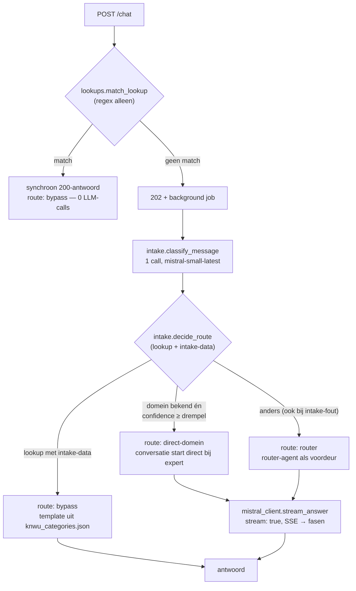

# Hoe een vraag geroute wordt

> [!WARNING]
> Deze pagina is door AI gegenereerd en nog niet door een mens gereviewd.

Elke vraag van de gebruiker krijgt in de app één van drie **routes**: `bypass`, `direct-<domein>` of `router`. Bij `bypass` beantwoordt Python de vraag deterministisch, zonder LLM-call. Bij de andere twee routes gaat het bericht naar een Mistral-agent. Dit overzicht laat zien welke route wanneer gekozen wordt, welke modellen daarbij draaien, en waar je dat in de code terugvindt — als opstap om verbeteringen aan de routing te begrijpen en te beoordelen.

Termen als *route*, *intake*, *deterministische bypass* en *fase* staan in het [GLOSSARY.md](../../GLOSSARY.md).

## De flow van een bericht

Zonder `MISTRAL_API_KEY`/`MISTRAL_AGENT_ID` draait de app in stub-mode: elk bericht krijgt synchroon een gemarkeerd stub-antwoord (handig voor offline development en tests).

## De drie routes

| Route | Wanneer | LLM-calls | Bepaald in |
| --- | --- | --- | --- |
| `bypass` | Pure feitelijke lookup met complete data: leeftijdscategorie, licentie, maximaal verzet per discipline, vertaling van een oude categorie-aanduiding | 0 — Python antwoordt uit `app/knwu_categories.json` | `app/lookups.py` (`match_lookup`, `render_lookup_answer`) |
| `direct-<domein>` | Intake bepaalt het domein met `confidence ≥ INTAKE_CONFIDENCE_THRESHOLD` (default 0,8) én er is een expert-id geconfigureerd voor dat domein | 1 intake-call + de expert-call | `app/intake.py` (`decide_route`), `config.EXPERT_AGENT_IDS` |
| `router` | Alles anders: vage vragen, lage confidence, geen expert-id, of een intake-fout (de fallback is altijd de router — veilig) | 1 intake-call + router-call (+ expert-call na handoff) | `app/intake.py`, `config.MISTRAL_AGENT_ID` |

De route is zichtbaar in `GET /chat/status/{job_id}` als `route` (`bypass` \| `direct-knwu` \| `router`) en in de eval (zie onder).

## Welke modellen worden gebruikt

| Model | Waarvoor | API | Config |
| --- | --- | --- | --- |
| `mistral-small-latest` | Light-model intake: één call per bericht die het bericht als JSON classificeert (intentie, domein, discipline, geboortejaar, confidence), temperature 0 | Chat Completions API | `MISTRAL_INTAKE_MODEL`, prompt in `app/prompts/intake-system.md` |
| `mistral-small-latest` | `router-agent`: alleen de voordeur, bepaalt het vraagtype en handofft | Conversations API | `scripts/architectures/huidig.json` |
| `mistral-large-latest` | De domeinexperts `knwu-agent`, `regio-agent`, `club-agent`, `archief-agent` (RAG via `document_library`, `web_search`, handoffs) | Conversations API, `stream: true` | `scripts/architectures/huidig.json` |
| geen model (Python) | `bypass`-antwoorden uit `app/knwu_categories.json` | — | `app/lookups.py` |

Alle LLM-calls zitten in de dunne laag `app/mistral_client.py`. De expert-call streamt (SSE); de events voeden de fase in `/chat/status` (`app/phases.py`). Als de stream niet start, valt de job terug op de non-streaming call (`StreamStartError`, #93). Prompt caching staat aan via `PROMPT_CACHE_KEY` (gecachte input kost 10% van de prijs). De agent-definities (model, library, websearch, handoffs per agent) zijn switchbaar via de active-pointer `scripts/architectures/active` (#95).

## Vragen die Python zelf beantwoordt (deterministische bypass)

`lookups.match_lookup()` herkent vier pure lookup-vragen, op basis van regex plus data uit `knwu_categories.json`:

- **leeftijdscategorie** op basis van een geboortejaar (ook een kaal jaartal als vervolg in een bestaand gesprek);
- **licentie** op basis van een geboortejaar;
- **maximaal verzet** per leeftijdscategorie én discipline;
- **vertaling** van een oude aanduiding ("categorie 3", "nieuwelingen") of kalender-aanduiding ("MU12, VU13").

Een bypass gebeurt alleen als de vraag alléén het kale feit vraagt. De guards in `lookups.py` sturen de rest door naar een agent:

- `MEER_DAN_FEIT` (woorden als *waarom, versie, bron, heb je dit gecheckt, kosten*…) → geen bypass;
- `REGELMENT_ONDERWERP` (wedstrijd, verzekering, contributie, training…) → geen bypass;
- meerdere onderwerpen in één vraag (bv. categorie én licentie) → geen bypass;
- geen geboortejaar bekend → geen bypass, de agent vraagt ernaar.

Het bypass-antwoord is een template met bron + versie + artikel — de `Bron:`-regel alleen bij taalniveau B2 (#52) — en eindigt altijd op een vaste disclaimer dat de library geraadpleegd wordt bij een vervolgvraag. De check draait niet alleen vóór een nieuwe job: `/chat` probeert `match_lookup` eerst zelf, ook midden in een bestaand gesprek, en antwoordt dan synchroon zonder job. In de background job kan `decide_route` met de intake-data (geboortejaar/discipline uit de LLM) alsnog een bypass opleveren; die job zet dan de fase "Ik bereken de leeftijdscategorie…".

## Contextregels bij de LLM-routes

Ook als een vraag naar een agent gaat, rekent de app zelf: `app/context.py` voegt deterministische contextregels toe onder het gebruikersbericht — het taalniveau (B1/B2), bij een nieuwe conversatie de datum, per geboortejaar de leeftijdscategorie (weg én veldritseizoen) en licentie, en vertalingen van oude/kalender-aanduidingen (#44, #61). De agents hoeven dus geen categorie uit te rekenen.

## Agents, tools en handoffs

De router en vier experts staan in `scripts/architectures/huidig.json`. Elke expert heeft één eigen library (`knwu`, `regio`, `club`, `archive`) en opzoekt via `document_library`; `web_search` is alleen aan voor de knwu- en regio-agent, met een allowlist van `knwu.nl` en `knwumidden.nl` (zie [ADR-0004](../adr/0004-websearch-beperkt-tot-kenniscentrum.md)). Experts handoffen bij onderwerpwissel direct naar elkaar, niet meer terug naar de router (zie [ADR-0009](../adr/0009-agent-architectuur-snelheid.md)). De bronvolgorde per vraagtype staat in het [GLOSSARY.md](../../GLOSSARY.md) en in [ADR-0003](../adr/0003-rag-over-eigen-documenten-kenniscentrum-autoriteit.md).

## Voorbeelden van vragen per route

Voorbeelden uit `app/tests/test_intake.py` en `eval/evalset.yaml` (`verwacht_route`):

| Vraag | Route | Waarom |
| --- | --- | --- |
| "In welke leeftijdscategorie rijdt een jongen geboren in 2015?" | `bypass` | categorie-vraag + geboortejaar, geen "meer dan feit"-woorden |
| "Wat is het maximaal toegestane verzet voor jongens U15 bij wegwielrennen?" | `bypass` | verzet-vraag met categorie U15 én discipline weg |
| "2015" (kaal jaartal als vervolg op de vraag naar het geboortejaar) | `bypass` | kaal jaartal = geboortejaar (#91 besluit 5) |
| "Wat is categorie 3 in de nieuwe indeling?" | `bypass` | vertaling van een oude aanduiding |
| "Waarom is het verzet voor U15 maar 6,70 meter?" | géén bypass → agent | `MEER_DAN_FEIT` treft "waarom" |
| "Wat kost de contributie bij WTC Woerden?" | `direct-club` (bij confidence ≥ 0,8) | intake ziet domein `club`; "kosten" is pas bij de lookup-guard een probleem, niet bij de intake-route |
| "Hoe zit het met die wedstrijd?" | `router` | vage vraag, lage confidence |
| "Wat is er veranderd in Titel 20?" | `router` als er geen archief-expert-id is geconfigureerd | zonder `MISTRAL_AGENT_ID_ARCHIEF` is geen direct-to-expert mogelijk |

## Zichtbaarheid, eval en tests

- De route staat per job in `GET /chat/status/{job_id}` (`route`), de fase in dezelfde response (`app/phases.py`).
- De eval spiegelt de productie-flow: `eval/run_eval.py` gebruikt dezelfde `match_lookup` + `intake.decide_route`. In `eval/evalset.yaml` assert `verwacht_route` per vraag de route; `eval/last_run.json` rapporteert `per_route`. Zie [reference: eval-set](../reference/eval-set.md).
- Tests: `app/tests/test_intake.py` (route-beslissing incl. fallback), `app/tests/test_lookups.py` (welke vragen bypassen).

## Configuratieknobs voor de routing

| Env var | Default | Effect |
| --- | --- | --- |
| `MISTRAL_INTAKE_MODEL` | `mistral-small-latest` | Model van de intake-call |
| `INTAKE_CONFIDENCE_THRESHOLD` | `0.8` | Drempel voor direct-to-expert |
| `INTAKE_TIMEOUT` | `30` | Timeout van de intake-call (seconden) |
| `MISTRAL_AGENT_ID_KNWU/_REGIO/_CLUB/_ARCHIEF` | leeg | Zonder id start er voor dat domein nooit direct een expert-conversatie |
| `MISTRAL_AGENT_ID` | leeg | Router-agent; zonder key + id draait de app in stub-mode |
| `PROMPT_CACHE_KEY` | `wtchatbot-v1` | Prompt caching aan (gecachte input = 10% prijs) |

## Afwegingen achter de huidige routing

- [ADR-0009](../adr/0009-agent-architectuur-snelheid.md): kleine router als voordeur, direct-to-expert bij hoge intake-confidence, deterministische bypass voor pure lookups, geen aparte zoek-agents en geen return-handoff. Een makkelijke lookup kost zo 0 LLM-calls (was 2). Trade-off: een small router is zwakker bij vage vragen — gecompenseerd doordat de intake bij lage confidence altijd de router inschakelt.
- [ADR-0003](../adr/0003-rag-over-eigen-documenten-kenniscentrum-autoriteit.md): RAG zit in de domeinexperts, niet in aparte zoek-agents; bronvolgorde per vraagtype.
- [ADR-0004](../adr/0004-websearch-beperkt-tot-kenniscentrum.md): websearch alleen via allowlist, als fallback op de bibliotheken.
- [ADR-0006](../adr/0006-verzettenadvies-hybride-rag-plus-calculator.md): het geplande verzettenadvies (post-MVP) houdt de regel via RAG en de rekensom deterministisch — de bypass van het kale max-verzet raakt dat niet.

## Waar in de code

- `app/main.py` — `POST /chat` (eerste lookup-check, 202 + job), `_run_chat_job` (intake → route → stream), `GET /chat/status`
- `app/intake.py` — `classify_message` (light LLM-call) en `decide_route` (bypass | direct | router)
- `app/lookups.py` — `match_lookup` (guards + patronen) en `render_lookup_answer` (template-antwoord)
- `app/context.py` — deterministische contextregels onder elk bericht
- `app/phases.py` — SSE-event → fase-tekst
- `app/mistral_client.py` — dunne API-laag: álle LLM-calls (stream, non-streaming fallback, intake-call)
- `app/config.py` — alle env vars uit de tabel hierboven
- `app/knwu_categories.json` — data voor de bypass (categorieën, licenties, verzetten, oude indeling, bron/versie)
- `scripts/architectures/huidig.json` + `scripts/architectures/active` — agent-definities (model, library, websearch, handoffs)
- `app/prompts/intake-system.md` — de intake-prompt
