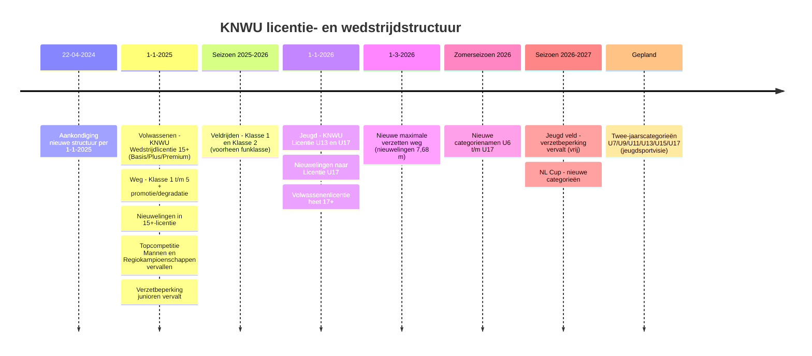
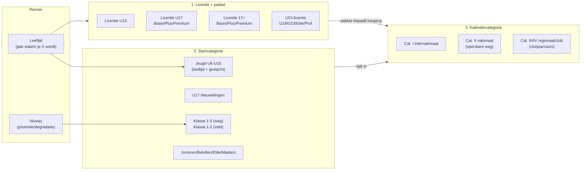
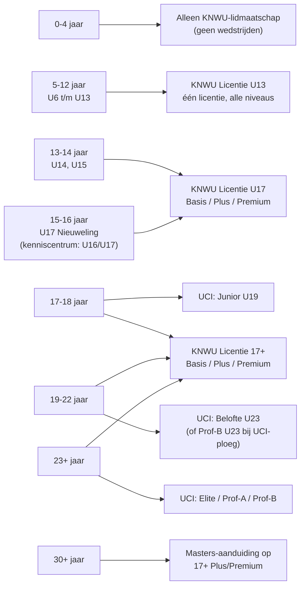
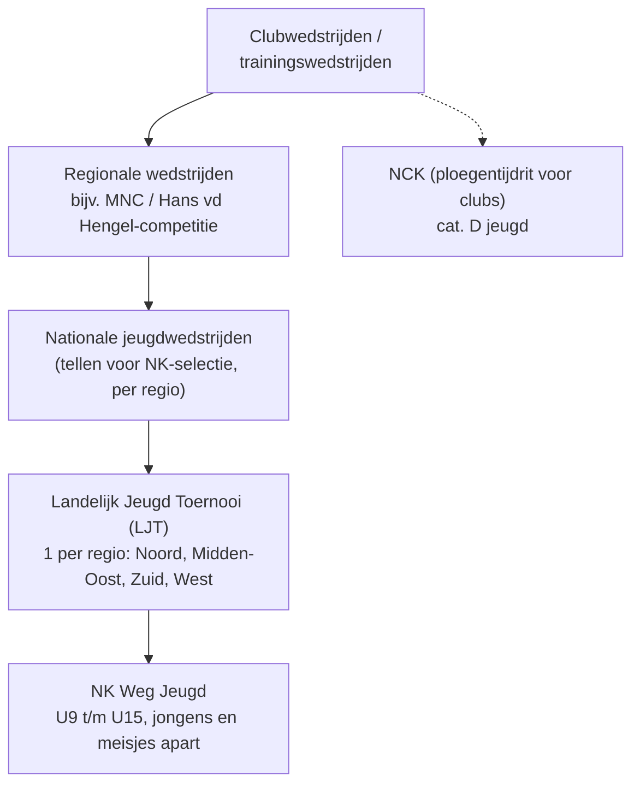
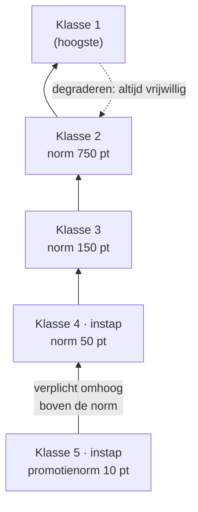
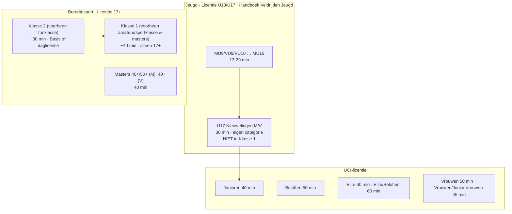

# KNWU licentie- en wedstrijdstructuur — Wegwielrennen en Veldrijden

> **Onderzoeksdatum:** 12-11-2026
> **Bronnen:** alleen KNWU: de documenten in deze repo (`knowledge-documents/knwu/`, `regio/`, `club/`), kenniscentrum.knwu.nl, knwu.nl en de PDF's die daar gelinkt zijn (op `static.helpjuice.com`).
> **Doel:** overzicht van (1) de licentie-indeling per leeftijd en (2) welke wedstrijden er per leeftijd zijn, voor de weg en het veld. Elke bewering heeft een voetnoot, zodat je die later opnieuw kunt controleren. Achteraan staat een [bronnenregister](#10-bronnenregister-voor-latere-controle).
> **Documenttype / status:** afgeleid onderzoeksdocument met open bronconflicten; geen officieel KNWU-reglement en geen bewijs dat een regel vandaag nog geldt.
> **Scope:** wegwielrennen en veldrijden; jeugd (U13/U17), junioren en volwassenen (licentiepakketten, startcategorieen, klassen en wedstrijdstatus).
> **Tijddekking:** situatie onderzocht op 12-11-2026, met historische wijzigingen vanaf 2025 en veldseizoen 2026-2027. De onderzoeksdatum is geen ingangsdatum van een regel en geen garantie dat alle onzekerheden zijn opgelost.
> **Autoriteit:** volg de bronhierarchie in [ADR-0003](../docs/adr/0003-rag-over-eigen-documenten-kenniscentrum-autoriteit.md). Een lokaal club- of regiodocument is niet automatisch een landelijke KNWU-bron.
> **Gebruik door agents:** controleer bij actuele vragen de primaire bron en de toepasselijke datum/het seizoen; lees ook de bronconflicten en open vragen in secties 8 en 9. Behoud onbevestigde informatie als onzeker, niet als vastgestelde regel.
> **Publicatie:** referentie voor onderzoek en onderhoud; dit bestand op de hoofdmap wordt niet naar de chatbot-libraries gesynchroniseerd. Voeg het niet als primaire bron toe aan `versions.json`.
> **Actualiseren:** gebruik [actualiseer-knwu-structuurdocument](../.github/prompts/actualiseer-knwu-structuurdocument.prompt.md); leg gedeeltelijke controles vast bij de gecontroleerde onderwerpen, zonder de onderzoeksdatum voor het hele document te vernieuwen.

---

## Samenvatting

De KNWU heeft de structuur in **twee stappen** veranderd:

1. **2025 — volwassenen.** De startlicentie, sportklasse-, amateur- en nieuwelingenlicentie zijn vervangen door één KNWU-wedstrijdlicentie. In 2025 heette die "15+". Je kiest daarbij een pakket: **Basis, Plus of Premium**. Op de weg rijd je voortaan in **Klasse 1 t/m 5**, op niveau en niet op leeftijd of geslacht. Een promotie-/degradatieregeling bepaalt je klasse[^dossier][^denkmee].
2. **2026 — jeugd.** Er zijn nu twee jeugdlicenties: de **KNWU Licentie U13** (5 t/m 12 jaar) en de **KNWU Licentie U17** (13 t/m 16 jaar). De nieuwelingen gingen daarmee van de 15+-licentie naar de U17-licentie. De licentie voor volwassenen heet nu **KNWU Licentie 17+**[^u13][^faq][^algemeen].

In het **veldrijden** geldt de klasse-indeling sinds seizoen 2025-2026. Er zijn alleen **Klasse 1** en **Klasse 2**, en er is (nog) geen promotie/degradatie[^veldnieuws][^nb51]. Junioren (U19), beloften (U23), elite en profs rijden met een **UCI-licentie**. Voor hen veranderde er niets[^flowchart]. Er zijn drie losse indelingen die je niet moet verwarren:

- **Licentie(pakket):** welke wedstrijden je mag rijden.
- **Startcategorie:** tegen wie je rijdt (leeftijd of klasse).
- **Kalendercategorie** (Cat. I/II/IV): het niveau van de wedstrijd.

---

## Leeswijzer en aannames

Bij deze opdracht kon ik je geen vragen stellen. Ik heb daarom deze keuzes gemaakt (zie ook [§9](#9-vragen-aan-jou-voor-richting)):

- **Volwassenen** = iedereen vanaf 17 jaar: de KNWU Licentie 17+ en de UCI-licenties. **Jeugd** = de licenties U13 en U17.
- Bij een tegenstrijdigheid geldt de **reglementstekst** (Titel 20, Nationale Besluiten) voor de inhoud. Het kenniscentrum geldt voor pakketten, prijzen en verzekering. Dat is ook de afspraak in deze repo (ADR-0003)[^adr3].
- "Leeftijd" betekent steeds **de leeftijd die je in dat kalenderjaar bereikt**, niet je leeftijd op de wedstrijddag[^t20cat][^t01leeftijd].
- Regionale competities (MNC) staan erin als **voorbeeld** van regionaal aanbod. Ze zijn regionaal en dus niet landelijk geldend.

---

## 1. Tijdlijn van de wijzigingen

Bronnen: aankondiging[^denkmee], dossier 2025[^dossier], veldnieuws[^veldnieuws], jeugdbeleid 2026[^jeugdbeleid], licenties per 01-01-2026[^algemeen], verzetten[^t20verzet][^verzetpagina], categorienamen[^u17], handboek veld 2026-2027[^hbwijziging], NL Cup[^nlcup], jeugdsportvisie[^visie2026].

> ⚠️ **Ingangsdatum nieuwelingen.** De nieuwelingenpagina zegt *"vanaf 2025 de nieuwe KNWU Licentie U17"*[^nwl], de FAQ zegt *"vanaf 2026"*[^faq]. In 2025 zaten de nieuwelingen in de **15+**-licentie[^dossier]. De U17-licentie bestaat pas sinds 1-1-2026. "2026" is dus de juiste datum.

---

## 2. Drie losse indelingen

| Indeling | Bepaalt | Bron |
|---|---|---|
| **Licentie + pakket** | Welke wedstrijden je mag rijden en hoe je verzekerd bent. Basis = regionaal (clubparcours). Plus = ook nationaal (openbare weg), NK en internationaal. Premium = Plus + wereldwijde aansprakelijkheidsverzekering. | [^p17][^u17][^overzicht] |
| **Startcategorie** | Tegen wie je rijdt. Jeugd en nieuwelingen op leeftijd (en geslacht). 17+ op de weg in Klasse 1-5 op niveau. UCI-categorieën op leeftijd/contract. | [^t20cat][^faq][^t01cat] |
| **Kalendercategorie** | Niveau van de wedstrijd. **Cat. I** = internationale kalender, **Cat. II** = nationale kalender, **Cat. III & IV** = regiokalender en (inter)clubwedstrijden. Cat. III valt in de overgangsfase onder Cat. IV. | [^t01wedsoort][^nbcat] |

> Een **Basis**-pakket geeft geen toegang tot Cat. 2-wedstrijden (de nationale kalender)[^t01wedsoort]. "Klasse 1/2" in het **internationale** veldrijden (C1/C2) is een niveau van de wedstrijd, geen klasse van de renner[^t05].

---

## 3. Licentie-indeling per leeftijd

### 3.1 Hoe je leeftijd telt

- **Weg (en MTB/gravel):** je categorie hangt af van **het jaar waarin je een leeftijd bereikt**. Voorbeeld: U9 = het jaar waarin je 8 wordt[^t20cat][^u13].
- **Veld (en baan):** je rijdt het hele seizoen (september–maart) in de categorie **waarin je op 1 januari van dat seizoen valt**. In de praktijk rijd je in het veld dus **één categorie hoger** dan op de weg in hetzelfde najaar[^t20cat][^nb51][^t05].
  - Voorbeeld van het kenniscentrum: *"Rijd je van maart tot september op de weg in jeugdcategorie U9, dan rijd je vervolgens het veldseizoen (oktober–maart) in jeugdcategorie U10."*[^u13]
- Elke licentie geldt **één kalenderjaar** (1 januari t/m 31 december)[^nb14][^faq].

### 3.2 Overzicht

| Leeftijd in het jaar | Categorie (weg) | Licentie | Pakketten / prijs 2026 | Bron |
|---|---|---|---|---|
| 0–4 | – | Alleen KNWU-lidmaatschap (clubactiviteiten; trainen vanaf 5 jaar) | – | [^t20lic] |
| 5–12 | U6 t/m U13 | **KNWU Licentie U13** | Eén licentie, €26: club, regionaal, nationaal, internationaal, NK/EK/WK (mits gekwalificeerd) | [^t20lic][^u13] |
| 13–14 | U14, U15 | **KNWU Licentie U17** | Basis €26 / Plus €72 / Premium €135 | [^t20lic][^u17] |
| 15–16 | **U17 Nieuweling** (Titel 20) = U16/U17 (kenniscentrum) | **KNWU Licentie U17** | idem | [^t20lic][^u17][^adr3] |
| 17–18 | Junior (U19) **of** Klasse 1-5 | Keuze: **UCI Junior U19** of **KNWU Licentie 17+** | 17+: Basis €26 / Plus €98 / Premium €155 | [^nb17plus][^junior][^p17] |
| 19–22 | Belofte (U23) of Klasse 1-5 | UCI Belofte (zonder contract), Prof-B U23 (UCI-ploeg) of 17+ | – | [^belofte][^nbprof] |
| 23+ | Elite of Klasse 1-5 | UCI Elite (club/LDT, zonder contract), Prof-A/Prof-B (contract) of 17+ | – | [^elite][^nbprof] |
| 30+ | Masters (30+/40+/50+/60+) | 17+ **Plus/Premium** (Masters-aanduiding) of Elite | – | [^algemeen][^p17][^nbmasters] |

**Losse punten per licentie:**

- **U13:** alleen via een club. Er is geen pakketkeuze. Titel 20 zegt nog *"Deelname aan wedstrijden in de Cat. 2 & 4"*. Dat is een oude notatie voor nationale (Cat. 2) en regionale/clubwedstrijden (Cat. 4)[^t20lic][^t20review].
- **U17:** alleen via een club. Pakketten ([^u17]):

  | Wat | Basis | Plus | Premium |
  |---|---|---|---|
  | Regionale wedstrijden (clubparcoursen) + verzekerd | ✔ | ✔ | ✔ |
  | Nationale wedstrijden (openbare weg) + verzekerd | | ✔ | ✔ |
  | NK (mits gekwalificeerd) | | ✔ | ✔ |
  | Internationale wedstrijden (incl. UCI-ID) | | ✔ | ✔ |
  | Aansprakelijkheid NL/BE/DE | | ✔ | ✔ |
  | Aansprakelijkheid wereldwijd | | | ✔ |
  | Fysieke licentiepas | digitaal | digitaal | ✔ |

- **17+:** dezelfde pakketten, met bij Plus/Premium ook de aanduiding Masters, Cruiser en Challenge. Aan te vragen via een club, **KNWU Direct** of de NTB[^p17][^faq]. *"Er wordt dus niet meer gekeken naar bijvoorbeeld leeftijd of geslacht."*[^p17]
- **17/18-jarigen** mogen kiezen. *"Jongens en meisjes van 17-18 jaar zijn niet meer verplicht om een licentie als junior of junior-vrouw aan te vragen."* Met 17+ mogen ze **niet** in junioren-wedstrijden (Toekomstcup, Topcompetitie, NK). Ook niet in combinatiewedstrijden met Elite/Belofte[^nb17plus]. Voor *"het NK, de Topcompetitie en UCI wedstrijden heb je een Junior U19 licentie nodig"*[^junior].
- **UCI-licenties** (Junior, Belofte, Elite, Prof-A, Prof-B): *"Er verandert voor jou niets binnen de nieuwe licentiestructuur."*[^flowchart]
- **Masters:** vanaf **30 jaar**, op de Licentie 17+ (Plus of Premium)[^algemeen]. In het off-road (veld/MTB) geldt de masterklasse volgens Titel 01 pas vanaf **35 jaar**[^t01cat].

### 3.3 Daglicentie en lidmaatschap

| Soort | Voor wie | Wat mag | Bron |
|---|---|---|---|
| **Daglicentie basis** | Iedereen zonder licentie (U13, U17, 17+) | Regionale wedstrijden. Nieuwelingen ook klasse 1-5-wedstrijden op clubparcoursen. | [^dag][^faq] |
| **Daglicentie plus** | 17+ (zonder licentie of met Basis) | Eenmalig het Plus-aanbod (nationale wedstrijden) | [^dag][^faq] |
| Niet mogelijk met een daglicentie | – | Internationale wedstrijden, NK/EK/WK (kwalificatie en deelname) | [^dag] |
| Uitzondering | Masters 60+ | NK Masters met *Basis + daglicentie plus* | [^nbnkmasters] |

> ⚠️ **Verschil tussen bronnen.** Titel 20 art. 20.0.003 zegt dat deelname met lidmaatschap + (dag)licentie *"uitsluitend mogelijk [is] in Klasse 4 en 5 wedstrijden"*[^t20dag]. Het kenniscentrum noemt *regionale wedstrijden* voor U13/U17[^dag]. Volgens de clubpagina kan een daglicentie **niet** in de Midden Nederland Competitie[^clublic] (secundaire bron).

### 3.4 Oud → nieuw

**Volwassenen (2025)** — afbeeldingen en tekst van het dossier[^dossier]:

| Tot en met 2024 | Vanaf 2025 (weg) | Veld/MTB |
|---|---|---|
| Amateurlicentie | vooral **Klasse 1** | Klasse 1 |
| Sportklasselicentie | vooral **Klasse 2** | Klasse 1 |
| Startlicentie | vooral **Klasse 3** | (niet genoemd) |
| Funklasse | – | Klasse 2 |
| – (nieuw) | **Klasse 4 en 5** (instapklassen) | – |
| Nieuwelingen | 15+-licentie (2025) → **U17-licentie** (2026) | eigen categorie U17 |
| Masters | Klasse 1-5 + aparte mastersraces | Klasse 1 / Masters 40+/50+ |

**Jeugd (2026)** — infographic *"Vernieuwde benaming (jeugd)categorieën"* (afbeelding op het kenniscentrum)[^infographic], met de clubsamenvatting als aanvulling[^clubcat]:

| T/m 31-12-2025 | Vanaf 2026 (jongens / meisjes) |
|---|---|
| CAT 1 | Jongens U9 / Meisjes U9 & U10 |
| CAT 2 | Jongens U10 / Meisjes U11 |
| CAT 3 | Jongens U11 / Meisjes U12 |
| CAT 4 | Jongens U12 / Meisjes U13 |
| CAT 5 | Jongens U13 / Meisjes U14 |
| CAT 6 | Jongens U14 / Meisjes U15 |
| CAT 7 | Jongens U15 |
| Nieuwelingen | U17 |
| Junioren | U19 |
| Beloften | U23 |
| Elite | Elite |

De oude licenties voor de jeugd waren *"U15 en 15+"*. Vanaf 2026 is dat *"U13, U17 en 17+"*[^u13]. In 2025 heetten ze de startlicentie jeugd (€14) en de jeugdlicentie (€51)[^dossier].

---

## 4. Jeugdcategorieën (U6 t/m U17)

### 4.1 Categorie per leeftijd (Titel 20 art. 20.0.004)[^t20cat]

| Categorie | Het jaar waarin je … wordt | Licentie |
|---|---|---|
| U6 | 5 | U13 |
| U7 | 6 | U13 |
| U8 | 7 | U13 |
| U9 | 8 | U13 |
| U10 | 9 | U13 |
| U11 | 10 | U13 |
| U12 | 11 | U13 |
| U13 | 12 | U13 |
| U14 | 13 | U17 |
| U15 | 14 | U17 |
| **U17 Nieuweling** | 15 of 16 | U17 |

> ⚠️ Het kenniscentrum maakt van de U17-licentie **vier** categorieën: U14, U15, **U16** (jaar waarin je 15 wordt) en **U17** (jaar waarin je 16 wordt)[^u17]. Titel 20 (21-09-2026) heeft één categorie "U17 Nieuweling" voor 15 en 16[^t20cat]. Alleen bij het **NK Veldrijden Jeugd** kan de commissie U16 en U17 apart laten rijden[^t20veld]. De repo volgt Titel 20 (ADR-0003)[^adr3].

### 4.2 Jongens en meisjes rijden samen

In wedstrijden rijden **meisjes samen met jongens die één jaar jonger zijn**. Een meisje houdt haar eigen categorienaam. Deze paren staan in alle tabellen van Titel 20[^t20deeln][^t20verzet][^t20afstand]. De Nationale Besluiten zeggen: *"Voor de selectieprocedure en het LJT rijden de meisjes 1 U-categorie lager dan hun leeftijd(geboortejaar)."*[^nbnkjeugd]

| Jongens | U6 | U7 | U8 | U9 | U10 | U11 | U12 | U13 | U14 | U15 | U17 Nwl |
|---|---|---|---|---|---|---|---|---|---|---|---|
| **Meisjes** | U6, U7 | U8 | U9 | U9, U10 | U11 | U12 | U13 | U14 | U15 | – | U17 Nwl |

In het veld heten de categorieën **MUx/VUx** (mannen/vrouwen), bijvoorbeeld *MU10/VU11*[^hbcat]. De regionale MNC-wegcompetitie gebruikt **JOx/MOx**, bijvoorbeeld *JO10/MO11*[^mncweg].

> **Gepland, nog niet in het reglement:** de jeugdsportvisie wil een *"uniforme leeftijdsindeling conform UCI, meiden en jongens gelijk trekken naar … U7, U9, U11, U13, U15 en U17"*[^visie2026]. Titel 20 (21-09-2026) heeft nog jaarcategorieën en de jongen/meisje-verschuiving[^t20cat].

---

## 5. Wedstrijdstructuur Wegwielrennen

### 5.1 Jeugd U6 t/m U15 (Licentie U13, en U17 voor U14/U15)

**Wedstrijdvormen** (art. 20.2.001): criterium, klassementswedstrijd, individuele tijdrit, ploegentijdrit, omnium. Een eendaagse wegwedstrijd mag alleen als nationale wedstrijd[^t20wvorm].

**Soorten wedstrijden** (art. 20.0.008/20.0.012)[^t20soort]:

- **Nationale wedstrijden:** nationale kampioenschappen, jeugdtoernooien (voor NK-kwalificatie), eendaagse/meerdaagse wegwedstrijden en vakantiekampen.
- **Regionale wedstrijden en clubwedstrijden** op een clubparcours, of als criterium op een stratenparcours.

**NK Weg Jeugd**[^t20nk][^nbnkjeugd]

- De regio's regelen de selectie. Het klassement telt de **5 beste resultaten**.
- Meedoen kan in de categorieën MU9-VU9-VU10 t/m MU15. **U6 t/m U8 rijden geen NK** en krijgen er ook geen dispensatie voor.
- Je moet vóór het NK **minimaal 2 wedstrijden** gereden hebben. Eén daarvan mag uit het vorige seizoen komen.
- Jongens en meisjes hebben elk een eigen NK, in de gebruikelijke paren (bijv. Jongens U10 + Meisjes U11).
- Na het NK Veldrijden volgen 6 weken wedstrijden zonder punten. Die tellen niet mee voor het NK Weg Jeugd.

**Maximale afstanden (art. 20.2.004)**[^t20afstand]

| Jongens | Meisjes | Criterium | Tijdrit | Ploegentijdrit | Criterium op omloop / NK |
|---|---|---|---|---|---|
| U6 | U6, U7 | 3 km | – | – | – |
| U7 | U8 | 3 km | – | – | – |
| U8 | U9 | 4 km | – | – | – |
| U9 | U9, U10 | 6 km | 2 km | 4 km | 6–10 km |
| U10 | U11 | 8 km | 3 km | 6 km | 8–12 km |
| U11 | U12 | 12 km | 4 km | 8 km | 12–16 km |
| U12 | U13 | 15 km | 6 km | 10 km | 15–20 km |
| U13 | U14 | 20 km | 8 km | 12 km | 20–27 km |
| U14 | U15 | 25 km | 10 km | 14 km | 25–32 km |
| U15 | – | 35 km | 15 km | 20 km | 35–45 km |
| U17 (Nwl) | U17 (Nwl) | 60 km | 15 km | 20 km | 80 km |

**Maximale verzetten (art. 20.1.007, versie 21-09-2026)**[^t20verzet]

| Jongens | Meisjes | Weg | Baan | Veld |
|---|---|---|---|---|
| U6–U8 | U6,U7 / U8 / U9 | 5,50 m | – | – |
| U9–U10 | U9,U10 / U11 | 5,50 m | 5,46 m | vrij |
| U11–U12 | U12 / U13 | 5,90 m | 5,78 m | vrij |
| U13–U14 | U14 / U15 | 6,30 m | 6,14 m | vrij |
| U15 | – | 6,70 m | 6,55 m | vrij |
| U17 (Nwl) | U17 (Nwl) | 7,68 m | 7,41 m | vrij |

> ⚠️ De PDF van Titel 20 laat oude waarden doorgestreept zien (bijv. ~~7,01~~ 7,68; ~~5,61 m~~ vrij). Bij tekst-extractie lopen die door elkaar. De waarden hierboven zijn de geldige, gecontroleerd met het opschoonrapport en de PDF-pagina als afbeelding[^t20review][^webt20]. De kenniscentrumpagina *Verzetten* (23-02-2026) linkt nog naar de oude Titel 20 van **06-02-2026**[^verzetpagina].

**Maximaal aantal deelnemers op de weg (art. 20.1.003):** van 20 (U6) tot 75 (U15 en U17)[^t20deeln].

**Overige jeugdregels**

- Twee wedstrijden op één dag mag niet onder de 17 jaar[^nb153].
- Dispensatie om hoger te rijden kan op basis van resultaten. Lager rijden (max. 1 categorie) kan bij een achterstand van meer dan 1 ronde in 3 wedstrijden achter elkaar[^t20disp].
- Bij weinig deelnemers mogen twee categorieën samen starten, met aparte uitslagen[^t20comb].

**Regionaal voorbeeld — MNC / In Memoriam Hans van den Hengel-competitie (2026)**[^mncweg]

- Categorieën JO9/MO10 t/m JO15/MO16, in drie startgroepen (6–30 km).
- Je hebt een geldige Licentie U13 of U17 (Basis, Plus of Premium) nodig. Meedoen is gratis.
- Wedstrijdvormen: criterium, tijdrit, ploegentijdrit, puntenkoers en techniekparcours.

### 5.2 U17 Nieuwelingen (15–16 jaar, Licentie U17)

Nieuwelingen kiezen per wedstrijd tussen twee soorten[^nwl][^u17]:

| Soort | Toelichting | Verzetcontrole | Pakket |
|---|---|---|---|
| **Klasse 1 t/m 5**-wedstrijden (breedtesport) | Indeling op niveau, samen met 17+. Je kunt promoveren en degraderen. | **Geen** | Basis = clubparcours. Plus/Premium = openbare weg. |
| **Nieuwelingenwedstrijden** (bijv. **Toekomstcup**) | Alleen voor U17 Nwl. Toekomstcup samen met junioren (M/V), alleen in teams. | **Wel** (7,68 m) | Plus of Premium |

- **NK Weg U17 (Nieuweling) Jongens/Meisjes:** je kunt je niet aanmelden. De eerste **125** van het *Regelmatigheidsklassement U17* worden uitgenodigd[^nbnkjun].
- De **Toekomstcup** levert punten op voor de nationale ranglijst (schema 2)[^nbtoek]. Het Reglement Toekomstcup 2026 noemt als categorieën *"U17 (Nieuwelingen) jongens"*/*meisjes* en *"Junioren mannen"*/*vrouwen*[^toekomst].
- **U17-meisjes** mogen in een U15-wedstrijd starten als er in Nederland geen wedstrijd voor hun eigen categorie is[^nbvrouw].
- Bij combinatiewedstrijden mogen nieuwelingen rijden met de klasse-indeling *"KLASSE 1-5 (V)/JUNIOREN/U17"*. Bij de NCK zitten ze in categorie B[^nbcomb][^nbnck].
- **Wat niet expliciet geregeld is:** of **U14/U15** (wel Licentie U17, geen nieuweling) in klasse 1-5 mogen rijden. De FAQ zegt: *"5 niveaus bij de renners van 15 jaar en ouder"* en *"enkel van toepassing voor de KNWU Licentie17+ en de nieuwelingen"*[^faq]. U14/U15 rijden dus in de **jeugdcategorieën**.

### 5.3 Volwassenen — Klasse 1 t/m 5 (Licentie 17+, en U17-nieuwelingen)

**Duur en vorm per klasse** (FAQ)[^faq]:

| Klasse | Duur | Racebegeleider | Parcours |
|---|---|---|---|
| 1 | ~60–90 min | – | omloop, criterium, clubparcours |
| 2 | ~60–75 min | – | omloop, criterium, clubparcours |
| 3 | ~60 min | – | omloop, criterium, clubparcours |
| 4 | ~45–60 min; eerste ~25% geneutraliseerd (35–37 km/u) | ✔ | omloop, clubparcours |
| 5 | ~40–60 min; eerste ~50% geneutraliseerd (30–35 km/u) | ✔ | omloop, clubparcours |

**Maximale afstanden in criteriums (Titel 02 art. 2.7.017.02)**[^t02]:

- Klasse 1 / junioren: 60–75 km.
- Klasse 2: 35–50 km.
- Klasse 3: 35–50 km (*"Basisleden max. 3 wedstrijden"*).
- Klasse 4-5: max. 35 km.

*"Alle nationale criteriums vallen onder de Cat. 2 wedstrijden."*

**Promotie/degradatie** (alleen op de weg, klasse 1 t/m 5)[^promo][^nbpromo]

- Punten gelden **365 dagen** (doorlopend).
- Je krijgt punten volgens een tabel per plaats en klasse. De winnaar krijgt in klasse 5/4/3/2/1 respectievelijk 6/20/100/250/1000 punten. Daarop komt een **deelnemersfactor**: 1,0 tot 20 starters, oplopend tot 1,5 vanaf 61 starters.
- *"Een sporter mag altijd in een klasse hoger rijden, … kan echter niet starten in een wedstrijd van een klasse lager… Degraderen is daarom altijd vrijwillig."*
- Je krijgt **geen punten** in doelgroepwedstrijden (vrouwen, masters, nieuwelingen). Uitzondering: de combinatie junioren/klasse 1[^promo][^nbcomb].
- Je klasse stel je in via **MijnKNWU**. Nieuwe renners worden verwezen naar de instapklassen 4 en 5[^faq][^wedstrijden].

> ⚠️ **Promotienorm klasse 3:** het kenniscentrum (02-10-2026) zegt **150**[^promo]. Het dossier van 2025 zegt **300**, met een oudere puntentabel[^dossier]. 150 is de actuele waarde. In de puntentabel van het kenniscentrum staan twee **typfouten in de bron**: klasse 3 plaats 9 = 14 en plaats 10 = 15; klasse 1 plaats 14 = 130 en plaats 15 = 150[^promo].

**Combinatiewedstrijden** (nationale kalender, vanaf 2025)[^nbcomb]

- **Mannen:** Prof-B/Elite/Beloften · Elite ZC/Beloften · Beloften ZC/Junioren · Junioren/Klasse 1*.
- **Vrouwen:** Prof-A/Prof-B/Elite/Beloften · Prof-B/Elite ZC/Beloften ZC/Klasse 1 (V) · Elite ZC/Beloften ZC/Klasse 1-3 (V) · Klasse 1-5 (V)/Junioren/U17.
- De vijf klassen **mogen niet samengevoegd worden**. Ze mogen wel tegelijk op één parcours rijden, met een aparte start en finish en een maximale groepsgrootte afhankelijk van de lengte van het parcours[^nbklasses].

**Vrouwen:** klasse 1 t/m 5 staat open voor alle geslachten. Er blijven ook aparte vrouwenwedstrijden en -combinaties[^faq][^nbvrouw].

**Masters, studenten, militairen:** *"De aparte wedstrijden voor bijvoorbeeld studenten, masters en militairen blijven op de kalender staan."*[^faq]

- **NK Weg Masters:** mannen 30+, 40+, 50+, 60+. Vanaf 50 wordt per 5 jaar gehuldigd.
- Je rijdt maar één NK per specialisatie: Elite, Clubmannen of Masters[^nbmasters][^nbnkmasters].

### 5.4 UCI-categorieën op de weg (junior, belofte, elite, prof)

| Licentie | Leeftijd | Weg: toegang | Bron |
|---|---|---|---|
| Junior U19 | 17–18 | NK, Cat. I, Cat. II (meerdaags, eendaags, omloop, criterium), Cat. IV (nationaal in het buitenland). Ook de Topcompetitie Junioren en de Toekomstcup. | [^junior][^nbcompet][^toekomst] |
| Belofte U23 | 19–22, zonder contract | NK/districtskampioenschappen Beloften, Cat. I/II/IV, U-23 Road Series, Clubcompetitie | [^belofte][^nbcompet] |
| Elite | 23+, club/LDT zonder contract | NK, Cat. I/II/IV, Clubcompetitie, UCI-wedstrijden | [^elite] |
| Prof-B / Prof-B U23 | contract Continental / Women's Pro / CX Pro | NK, Cat. I/II/IV, UCI-wedstrijden | [^nbprof] |
| Prof-A | WorldTeam / ProTeam / Women's WorldTeam | NK, Cat. I/II/IV, UCI-wedstrijden | [^nbprof] |

**Competities (Nationale Besluiten §2.6)**[^nbcompet]

- Topcompetitie Vrouwen
- Women Cycling Series (NL/BE)
- U-23 Road Series
- KNWU Clubcompetitie Mannen
- Topcompetitie Junioren Mannen (max. 168 renners, ploegen van 4 tot 6)
- Toekomstcup

*"De Topcompetitie Mannen wordt sinds 2025 niet meer verreden."* Ook de **Regiokampioenschappen** zijn per 2025 vervallen[^nbregio].

> Let op: Titel 01 (01-07-2026) schrijft nog *"Klasse 1-5 Vanaf 19 Jaar"* en *"Jeugd van 8 t/m 14 jaar"*[^t01cat]. Dat past niet bij de Nationale Besluiten (17+ en nieuwelingen) en Titel 20 (5 t/m 16). Zie [§8](#8-tegenstrijdigheden-en-open-punten).

---

## 6. Wedstrijdstructuur Veldrijden

### 6.1 Seizoen en categorie

- Het seizoen loopt van **september t/m maart**. Je categorie is die waarin je op **1 januari van het seizoen** valt. Dit geldt ook voor de jeugd[^nb51][^t20cat][^t05].
- Jeugd mag vanaf **7 jaar**, vanaf het begin van het veldseizoen, met een jeugdlicentie starten in **MU9/VU9**[^nb52].
- In het veld zijn de **verzetten voor de jeugd vrij** sinds seizoen 2026-2027[^t20verzet][^hbwijziging].

### 6.2 Opbouw

### 6.3 Jeugd U9 t/m U15 in het veld

**Categorieën 2026-2027 (Handboek Veldrijden Jeugd)**[^hbcat]

| Categorie | Jongens geboren | Meisjes geboren | Duur (art. 20.5.003)[^t20veld] |
|---|---|---|---|
| MU9/VU9/VU10 | 2019 | 2018 en 2019 | 13 min |
| MU10/VU11 | 2018 | 2017 | 16 min |
| MU11/VU12 | 2017 | 2016 | 19 min |
| MU12/VU13 | 2016 | 2015 | 21 min |
| MU13/VU14 | 2015 | 2014 | 24 min |
| MU14/VU15 | 2014 | 2013 | 26 min |
| MU15 | 2013 | – | 29 min |
| U17 Nieuwelingen | (15–16 jaar) | (15–16 jaar) | 30 min |

**Soorten wedstrijden**

- **Regionale veldritten.** Het kenniscentrum noemt als voorbeeld *"GOW, ACC en ICW"*. Wat die afkortingen betekenen, staat niet in de KNWU-bronnen. Regionaal is ook de **MNC Veldrijden**: jeugd in 2 starts (cat. 1-4 en cat. 5-7), een mountainbike is toegestaan, een KNWU-licentie verplicht[^overzicht][^mncveld].
- **Nationale (landelijke) jeugdveldritten.** Deze zijn *"een stapje hoger"* dan regionaal en bedoeld als doorstroom[^hbnat]. Tot 30 november wordt de startopstelling geloot. Daarna bepaalt het **regelmatigheidsklassement** de startvolgorde (beste 10 uitslagen; 30 punten voor de winnaar, dan 1 punt minder per plaats; geen onderscheid jongens/meisjes)[^hbnk][^nbveldjeugd].
- **NK Veldrijden Jeugd** (De Westereen, 23-01-2027)[^nb57]:
  - Jongens en meisjes hebben een eigen NK.
  - Nieuw voor 2026-2027: *"Om deel te nemen aan het NK dient men minimaal 1 nationale wedstrijd gereden hebben."*
  - Wie met dispensatie lager rijdt, mag het NK rijden in de categorie van dat seizoen[^hbnk][^hbwijziging].
- **Licentie:** *"Om deel te kunnen nemen aan de veldrit wedstrijden dien je een KNWU licentie U13/U17 te hebben."* Het Handboek noemt geen daglicentie[^hbcat].

**Parcoursregels (art. 20.5.001):**

- Jongens U9-U12 / meisjes U10-U13 moeten één keer afstappen.
- Hindernissen zijn tot en met U15 maximaal 20 cm hoog.
- U17 rijden *"op hetzelfde parcours met dezelfde reglementen als de junioren en hoger"*.
- Fietswissel mag pas vanaf U17[^t20veld].

### 6.4 Volwassenen in het veld

**Klasse-indeling (Nationale Besluiten §5.1, gewijzigd 18-09-2026)**[^nb51]

> *"Klasse 1: voorheen amateur/sportklasse & masters, +/- 40 minuten wedstrijd. Alleen toegankelijk voor KNWU wedstrijdlicentie 17+ renners.
> Klasse 2: voorheen funklasse, +/- 30 minuten wedstrijd
> U17 M/V (Nieuwelingen): … Kunnen alleen starten in de specifieke nieuwelingen categorie. Deze groep mag niet deelnemen in de klasse 1 veldritwedstrijden."*

- Voor **Klasse 2** is *"een KNWU wedstrijdlicentie basis en/of daglicentie verplicht"*[^nb58].
- De organisator kiest zelf welke klassen hij aanbiedt. Masters 40+ (en 50+) kunnen een eigen wedstrijd krijgen naast Klasse 1[^veldnieuws].
- Er is **geen promotie/degradatie** in het veld[^faq][^promo].

**Voorbeeldprogramma van een nationale veldrit 2025/2026 (KNWU)**[^veldnieuws]

| Start | Categorie |
|---|---|
| 09:00 | Klasse 2 m/v (voorheen funklasse) |
| 10:00 / 10:02 | Masters 40+ (M) / Masters 50+ (M) |
| 11:00 | Nieuwelingen (M) |
| 12:00 | Junioren (M) |
| 13:00 / 13:01 / 13:02 | Elite/beloften/Prof B/Klasse 1 (V) · Junioren (V) · Nieuwelingen (V) |
| 14:30 / 14:32 | Elite/beloften/Prof B (M) · Klasse 1 (voorheen amateur/sportklasse) (M) |

**Wedstrijdduur nationaal (§5.8)**[^nb58]

- Elite: 60 min
- Elite/Beloften: 60 min
- Beloften: 50 min
- Vrouwen: 50 min
- Vrouwen/Junior-vrouwen: 45 min
- Junioren: 40 min
- Klasse 1 (amateurs/masters): 40 min
- Nieuwelingen: 30 min
- Nieuweling-meisjes: 30 min

**Competities en kampioenschappen**

- **NL Cup Veldrijden:** 7 wedstrijden. Vanaf 2026-2027 *"zijn de categorieën Elite/Belofte (M), Masters 50+ (M) en Elite/Belofte (V) toegevoegd"*[^nlcup].
- **Regelmatigheidsklassement Veldrijden.** Voor mannen: Elite/Beloften, U17, U19, Klasse 1 en Masters 40+/50+. Voor vrouwen: Elite/Belofte/Klasse 1/U19, U17 en Masters 40+[^nbregelm].
- **NK Veldrijden** (Gemert, 9-10 januari 2027)[^nb57]. Volgens de KNWU *"een categorie voor Klasse 1 (tot en met 39 jaar) en daarnaast één of meer categorieën voor masters/agegroups"*[^veldnieuws].
- Kalendercategorieën in het veld: **Cat. I** internationaal, **Cat. II** nationaal, **Cat. IV** (inter)clubwedstrijden. In Cat. I en II is een mountainbike niet toegestaan[^t05][^nbcat].

### 6.5 Toegang per pakket in het veld (Licentie U17 en 17+)[^overzicht]

| Veldrijden | Basis | Plus | Premium |
|---|---|---|---|
| Regionale wedstrijden (zoals GOW, ACC, ICW) | ✔ | ✔ | ✔ |
| Nationale veldritten | | ✔ | ✔ |
| NK (U14, U15, U16 & U17 (Nwl), Masters) | | ✔ | ✔ |
| Internationale veldritten | | ✔ | ✔ |

UCI-licenties (Junior, Belofte, Elite, Prof) geven toegang tot NK, Cat. I/II/IV en de Topcompetitie in het veld[^junior][^belofte][^elite].

---

## 7. Overzichtsmatrix: leeftijd → licentie → wedstrijden

| Leeftijd in het jaar | Licentie | **Weg** | **Veld** (categorie per 1 januari van het seizoen) |
|---|---|---|---|
| 5–7 (U6–U8) | U13 | Criterium 3–4 km; club-, regionale en nationale jeugdwedstrijden; **geen NK** | Vanaf 7 jaar in MU9/VU9[^nb52] |
| 8–12 (U9–U13) | U13 | Jeugdwedstrijden (criterium, tijdrit, ploegentijdrit, omnium), NK Weg Jeugd via regioselectie + LJT, NCK | Regionaal + nationale jeugdveldritten, NK Veld Jeugd (min. 1 nationale wedstrijd) |
| 13–14 (U14–U15) | U17 Basis/Plus/Premium | Als hierboven (U15 max. 35 km). Basis = regionaal, Plus = nationaal/NK | Als hierboven. Basis = regionaal, Plus = nationaal/NK |
| 15–16 (U17 Nwl) | U17 | **Klasse 1–5** (op niveau) **of** nieuwelingenwedstrijden (Toekomstcup: Plus/Premium); NK U17 via regelmatigheidsklassement | Eigen categorie U17 (30 min), **niet** Klasse 1; NK Veld Jeugd (eventueel U16 en U17 apart) |
| 17–18 | Junior U19 **of** 17+ | Junior: NK, Topcompetitie, Toekomstcup, Cat. I/II/IV. 17+: Klasse 1–5 | Junior: 40 min, NK. 17+: Klasse 1 of 2 |
| 19–22 | Belofte/Prof-B U23 **of** 17+ | Beloften: Cat. I/II/IV, U-23 Road Series, Clubcompetitie. 17+: Klasse 1–5 | Beloften (50 min) / Elite-Beloften (60 min). 17+: Klasse 1 of 2 |
| 23+ | Elite/Prof **of** 17+ | Elite/Prof: Cat. I/II/IV, UCI. 17+: Klasse 1–5 | Elite 60 min. 17+: Klasse 1 of 2 |
| 30+ (veld: 40+) | 17+ Plus/Premium (Masters) | Mastersraces, NK Masters (30+/40+/50+/60+), of Klasse 1–5 | Masters 40+/50+ (40 min) of Klasse 1/2; NK masters |

---

## 8. Tegenstrijdigheden en open punten

| # | Onderwerp | Bron A | Bron B | Beoordeling |
|---|---|---|---|---|
| 1 | Naam voor 15–16 jaar | Titel 20: één categorie *U17 Nieuweling*[^t20cat] | Kenniscentrum: **U16** en **U17** apart[^u17] | De repo volgt Titel 20 (ADR-0003)[^adr3]. Splitsing alleen mogelijk bij NK Veld Jeugd[^t20veld]. |
| 2 | "15+" of "17+" | NB §5.1: *"wedstrijdlicentie 15+"* en in dezelfde passage *"17+"*[^nb51] | Kenniscentrum: Licentie 17+[^p17] | "15+" is de naam uit 2025 en is in §5.1 blijven staan. |
| 3 | Leeftijd klasse 1-5 en jeugd | Titel 01 (01-07-2026): *"Klasse 1-5 Vanaf 19 Jaar"*, *"Jeugd van 8 t/m 14 jaar"*[^t01cat] | NB: 17+ mag[^nb17plus]; FAQ: 15+[^faq]; Titel 20: 5–16[^t20lic] | Titel 01 loopt waarschijnlijk achter. Zelf nakijken. |
| 4 | Promotienorm klasse 3 | Kenniscentrum (02-10-2026): 150[^promo] | Dossier 2025: 300[^dossier] | **150 geldt.** De puntentabel heeft 2 typfouten in de bron. |
| 5 | Verzetten | Titel 20 (21-09-2026): veld vrij, nwl weg 7,68 m[^t20verzet] | Pagina *Verzetten* linkt nog Titel 20 van 06-02-2026[^verzetpagina] | De versie van 21-09-2026 staat op de reglementenpagina[^hub]. |
| 6 | Ingangsjaar U17-licentie nieuwelingen | Nieuwelingenpagina: "vanaf 2025"[^nwl] | FAQ: "vanaf 2026"[^faq] | 2026. In 2025 hadden ze de 15+-licentie[^dossier]. |
| 7 | Aantal veldklassen | FAQ: *"veldritten met 2 of 3 klasses"*[^faq] | NB §5.1: alleen Klasse 1, 2 (en U17)[^nb51]. Regionale MNC gebruikt weg-klassen 1-5 in A/B/C[^mncveld] | Landelijk 2 klassen. Klasse 3 niet bevestigd. |
| 8 | Daglicentie jeugd | Kenniscentrum: daglicentie basis voor U13/U17 regionaal[^dag] | Titel 20: alleen klasse 4/5[^t20dag]; clubpagina: niet in MNC[^clublic] | Per wedstrijd/organisator nakijken. |
| 9 | U14/U15 in klasse 1-5 | Niet expliciet geregeld | FAQ: niveaus voor "15 jaar en ouder" en nieuwelingen[^faq] | Afgeleid: U14/U15 rijden jeugdcategorieën. |
| 10 | Twee-jaarscategorieën | Jeugdsportvisie: U7/U9/…/U17 "in 2026 doorvoeren"[^visie2026] | Titel 20 (21-09-2026): jaarcategorieën[^t20cat] | Nog niet in het reglement. Volgen. |
| 11 | Categorietabel Handboek veld | Alleen MU9 t/m MU15[^hbcat] | Titel 20: U6–U17[^t20cat]; NB 5.2: 7-jarigen in MU9[^nb52] | Het Handboek dekt alleen de veldritcategorieën. |
| 12 | Niet gedefinieerd | **NSK**, **GOW/ACC/ICW** staan in de overzichtstabel[^overzicht] | Niet uitgelegd in KNWU-bronnen | Open. |
| 13 | Startlicentie in veld/MTB | Dossier noemt alleen amateur/sportklasse → 1 en funklasse → 2[^dossier] | – | Open. |

---

## 9. Vragen aan jou (voor richting)

Ik kon deze vragen tijdens het onderzoek niet stellen. Je antwoorden helpen bij een volgende versie.

1. **U16/U17:** gebruiken we in de chatbot de naam van Titel 20 (*U17 Nieuweling*), of noemen we U16 en U17 apart zoals het kenniscentrum?
2. **Titel 01, 02 en 05** (01-07-2026) staan **niet** in de repo. Ze bevatten de algemene definities (leeftijd, kalendercategorieën, clubparcours). Wil je ze toevoegen aan `knowledge-documents/knwu/`, of houden we het bij Titel 20, de Nationale Besluiten en het Handboek?
3. **Scope van de volwassenen:** is het niveau van dit rapport genoeg, of wil je ook UCI-elite/prof en de prijzenschema's uitgewerkt hebben?
4. **Regionaal:** wil je de MNC/regio-competities apart uitgewerkt hebben, of alleen als voorbeeld?

---

## 10. Bronnenregister (voor latere controle)

Alles **gecontroleerd op 12-11-2026**. Repo = `Atrium0804/WTChatbot`.

| ID | Bron | Versie / datum | Locatie |
|---|---|---|---|
| T20 | Titel 20 Jeugdwielrennen | 21-09-2026 | repo `knowledge-documents/knwu/TITEL_20-Jeugdwielrennen_20260921.md` · PDF: https://static.helpjuice.com/helpjuice_production/uploads/upload/image/7751/direct/1790071058084/TITEL_20-Jeugdwielrennen_20260921.pdf |
| T20-oud | Titel 20 Jeugdwielrennen | 06-02-2026 (vervangen) | https://static.helpjuice.com/helpjuice_production/uploads/upload/image/7751/direct/1770370953456/TITEL_20-Jeugdwielrennen_20260206.pdf |
| NB | Nationale Besluiten 2026 | 18-09-2026 | repo `knowledge-documents/knwu/Nationale_Besluiten_20260918.md` · PDF: https://static.helpjuice.com/helpjuice_production/uploads/upload/image/7751/direct/1790858184743/Nationale_Besluiten_20260918.pdf |
| HB | Handboek Veldrijden Jeugd 2026-2027 | v3.0, 18-09-2026 | repo `knowledge-documents/knwu/Handboek Veldrijden Jeugd 2026-2027.md` · PDF: https://static.helpjuice.com/helpjuice_production/uploads/upload/image/7751/direct/1789720220278/Handboek%20Veldrijden%20Jeugd%202026-2027.pdf |
| T01 | Titel 01 Algemene organisatie | 01-07-2026 | https://static.helpjuice.com/helpjuice_production/uploads/upload/image/7751/direct/1782812870294/Titel_01_Algemene_Organisatie_wielersport_20260701.pdf (niet in repo) |
| T02 | Titel 02 Wegwedstrijden | 01-07-2026 | https://static.helpjuice.com/helpjuice_production/uploads/upload/image/7751/direct/1782812947261/TITEL%2002-Wegwedstrijden_20260701.pdf (niet in repo) |
| T05 | Titel 05 Veldrijden | 01-07-2026 | https://static.helpjuice.com/helpjuice_production/uploads/upload/image/7751/direct/1787294728659/TITEL%2005-Veldrijden%20-%202026-07-01.pdf (niet in repo) |
| HUB | Reglementen en jaarlijkse besluiten | 01-10-2026 | https://kenniscentrum.knwu.nl/nl_NL/regelgeving/reglementen-en-jaarlijkse-besluiten |
| FAQ | Veelgestelde vragen nieuwe structuur | bijgewerkt 29-06-2026 (metadata) | https://kenniscentrum.knwu.nl/nl_NL/voor-renners/veelgestelde-vragen-nieuwe-structuur |
| ALG | De rennerslicenties ("Licenties per 01-01-2026") + icoon-diagram "Licentiestructuur 2025+" | – | https://kenniscentrum.knwu.nl/nl_NL/voor-renners/wedstrijdlicenties-algemeen |
| U13 | KNWU Licentie U13 | 07-11-2025 | https://kenniscentrum.knwu.nl/nl_NL/knwu-licenties/jeugd-u13 |
| U17 | KNWU Licentie U17 | 29-10-2026 | https://kenniscentrum.knwu.nl/nl_NL/knwu-licenties/knwu-wedstrijdlicentie-u17 |
| NWL | Nieuwelingen (15–16 jaar) | 04-11-2025 | https://kenniscentrum.knwu.nl/nl_NL/knwu-licenties/nieuwelingen-mv-15-tm-16-jaar |
| 17+ | KNWU Licentie 17+ | ~10-2026 | https://kenniscentrum.knwu.nl/nl_NL/knwu-licenties/knwu-wedstrijdlicentie |
| OVZ | Wedstrijdoverzicht per discipline | – | https://kenniscentrum.knwu.nl/nl_NL/knwu-licenties/wedstrijdoverzicht-per-discipline |
| PRO | Promotie- en degradatieregeling | 02-10-2026 | https://kenniscentrum.knwu.nl/nl_NL/knwu-licenties/de-promotie-en-degradatieregeling |
| DAG | Daglicentie | – | https://kenniscentrum.knwu.nl/nl_NL/knwu-licenties/daglicentie |
| JUN/BEL/ELI | UCI-licenties Junioren / Beloften / Elite | Junioren 09-02-2026 | https://kenniscentrum.knwu.nl/nl_NL/uci-licenties/junioren-m-v-17-t-m-18-jaar · …/976132-beloften-m-v-19-t-m-22-jaar · …/976122-elite-m-23-jaar |
| VERZ | Verzetten | 23-02-2026 (verouderd) | https://kenniscentrum.knwu.nl/nl_NL/regelgeving/verzetten |
| FLOW | Flowchart "Zo kies je het juiste licentiepakket" (afbeelding/PDF) | v5 | https://static.helpjuice.com/helpjuice_production/uploads/upload/image/7751/direct/1762529922274/Flowchart_licenties.pdf |
| INFO | Infographic "Vernieuwde benaming (jeugd)categorieën" (afbeelding) | ~02-2026 | https://static.helpjuice.com/helpjuice_production/uploads/upload/image/7751/direct/1770727935778/image.jpeg (op …/jeugdsportvisie/categorie-indeling) |
| VIS | Jeugdsportvisie: veranderingen 2026 | ~01/02-2026 | https://kenniscentrum.knwu.nl/nl_NL/jeugdsportvisie/welke-veranderingen-kunnen-we-verwachten-in-2026 |
| TC | Toekomstcup reglementen (Reglement 2026, versie feb 2026) | pagina 12-11-2026 | https://kenniscentrum.knwu.nl/nl_NL/toekomstcup/reglementen-en-aanmeldingsformulieren-toekomstcup |
| DOS | Dossier wedstrijd- en licentiestructuur 2025+ (incl. infographic en licentietabel 2025) | "dinsdag 4 maart" (2025) | https://www.knwu.nl/dossier-wedstrijd-en-licentiestructuur-2025-plus |
| N1 | Nieuws: Denk mee over de vernieuwde structuur | 22-04-2024 | https://www.knwu.nl/nieuws/denk-mee-over-de-vernieuwde-wedstrijd-en-licentiestructuur |
| N2 | Nieuws: Invoering klasse-indeling veldrijden | 04-03-2025 | https://www.knwu.nl/nieuws/invoering-klasse-indeling-veldrijden |
| N3 | Nieuws: Nieuw jeugdsportbeleid vanaf 2026 | 10-10-2025 | https://www.knwu.nl/nieuws/nieuw-jeugdsportbeleid-vanaf-2026-aanmelden-voor-online-kennissessies |
| N4 | Nieuws: Let op wijzigingen handboek veldrijden jeugd | 09-09-2026 | https://www.knwu.nl/nieuws/let-op-wijzigingen-handboek-veldrijden-jeugd |
| WED | Wedstrijden (instapklassen, "Bepaal jouw klasse") | ~03-2026 | https://www.knwu.nl/wedstrijden |
| MNC-W | MNC / Hans vd Hengel-competitie weg 2026 (regionaal) | 2026 | repo `knowledge-documents/regio/MNC 2026 Hans vd Hengelcompetitie - wegwielrennen.pdf` |
| MNC-V | Reglement MNC Veldrijden 2025-2026 (regionaal) | 07-09-2025 | repo `knowledge-documents/regio/MNC Reglement MNC Veldrijden 2025.pdf` |
| CLUB | Clubpagina's (secundair) | 10/2026 | repo `knowledge-documents/club/KNWU - leeftijdscategorieën.md`, `KNWU - Licenties.md` |

> **Tip voor de volgende controle:** de documentversies in de repo staan in `knowledge-documents/versions.json`[^versions]. Kijk eerst op de reglementenpagina (HUB) of er een nieuwere Titel 20 of nieuwere Nationale Besluiten zijn. Gebruik daarvoor de skill `knwu-documentwissel`.

---

## Betrouwbaarheid

**Hoog (letterlijk in de reglementstekst of meerdere bronnen eens):**

- Licentie-indeling U13/U17/17+ en de UCI-licenties.
- Leeftijd = het jaar waarin je die leeftijd bereikt; veldseizoen volgens 1 januari.
- Pakketinhoud Basis/Plus/Premium.
- Klasse 1-5 met promotienorm 10/50/150/750.
- Jeugdafstanden, -verzetten en veldritduur.
- Veld Klasse 1/2 en de uitsluiting van U17 uit Klasse 1.
- Selectie voor NK Weg Jeugd, NK U17 en NK Veld Jeugd.

**Middel (één bron, of afgeleid):**

- De ingangsdata, als volgorde opgebouwd uit gedateerde pagina's.
- De oud→nieuw-indeling van volwassenen ("voornamelijk").
- Dat U14/U15 niet in klasse 1-5 rijden. Afgeleid uit de FAQ, niet expliciet.
- Dat GOW/ACC/ICW regionale competities zijn (wel genoemd, niet uitgelegd).
- De datum van het dossier (2025): niet zichtbaar op de pagina, afgeleid.

**Laag / onopgelost:** de punten in [§8](#8-tegenstrijdigheden-en-open-punten), vooral #3 (Titel 01), #7 (veldklasse 3), #8 (daglicentie jeugd) en #12 (NSK, GOW/ACC/ICW).

**Afbeeldingen:** de informatie in afbeeldingen is overgetypt. Dat zijn de flowchart *"Zo kies je het juiste licentiepakket"*, de iconen *"Licentiestructuur 2025+"*, de infographics van het dossier 2025 en de infographic met de jeugdcategorieën. De FAQ-pagina zelf bevat geen afbeeldingen met inhoud; daar staan alle tabellen als tekst[^flowchart][^infographic][^dossier].

---

## Voetnoten

[^denkmee]: KNWU nieuws, *Denk mee over de vernieuwde wedstrijd- en licentiestructuur*, 22-04-2024 — https://www.knwu.nl/nieuws/denk-mee-over-de-vernieuwde-wedstrijd-en-licentiestructuur
[^dossier]: KNWU, *Dossier wedstrijd- en licentiestructuur 2025+* (tekst, promotietabel 2025, infographic *KNWU-Infographic-licentiestructuur-2025_groot.png*, *Licentietabel_v2*, flowchart 2025) — https://www.knwu.nl/dossier-wedstrijd-en-licentiestructuur-2025-plus
[^veldnieuws]: KNWU nieuws, *Invoering klasse-indeling veldrijden*, 04-03-2025 — https://www.knwu.nl/nieuws/invoering-klasse-indeling-veldrijden
[^jeugdbeleid]: KNWU nieuws, *Nieuw jeugdsportbeleid vanaf 2026*, 10-10-2025 — https://www.knwu.nl/nieuws/nieuw-jeugdsportbeleid-vanaf-2026-aanmelden-voor-online-kennissessies
[^hbwijziging]: KNWU nieuws, *Let op: wijzigingen handboek veldrijden jeugd*, 09-09-2026 — https://www.knwu.nl/nieuws/let-op-wijzigingen-handboek-veldrijden-jeugd
[^wedstrijden]: KNWU, *Wedstrijden* (instapklassen 4 en 5, "Bepaal jouw klasse") — https://www.knwu.nl/wedstrijden
[^algemeen]: Kenniscentrum, *De rennerslicenties — Licenties per 01-01-2026* — https://kenniscentrum.knwu.nl/nl_NL/voor-renners/wedstrijdlicenties-algemeen
[^faq]: Kenniscentrum, *Veelgestelde vragen nieuwe structuur* (o.a. "Waar zijn de startlicentie … gebleven?", "Hoeveel niveaus zijn er per discipline?", tabel duur per klasse, daglicentie) — https://kenniscentrum.knwu.nl/nl_NL/voor-renners/veelgestelde-vragen-nieuwe-structuur
[^u13]: Kenniscentrum, *KNWU Licentie U13* (leeftijdstabel U6–U13, voordelentabel, veld/baan-regel), 07-11-2025 — https://kenniscentrum.knwu.nl/nl_NL/knwu-licenties/jeugd-u13
[^u17]: Kenniscentrum, *KNWU Licentie U17* (U14–U17, pakketten €26/€72/€135, nieuwelingen in klasse 1-5), 29-10-2026 — https://kenniscentrum.knwu.nl/nl_NL/knwu-licenties/knwu-wedstrijdlicentie-u17
[^nwl]: Kenniscentrum, *Nieuwelingen (m/v) 15 t/m 16 jaar* (keuze klasse 1-5 of nieuwelingenwedstrijden, Toekomstcup Plus/Premium, verzetcontrole), 04-11-2025 — https://kenniscentrum.knwu.nl/nl_NL/knwu-licenties/nieuwelingen-mv-15-tm-16-jaar
[^p17]: Kenniscentrum, *KNWU Licentie 17+* (pakketten €26/€98/€155; "niet meer gekeken naar … leeftijd of geslacht") — https://kenniscentrum.knwu.nl/nl_NL/knwu-licenties/knwu-wedstrijdlicentie
[^overzicht]: Kenniscentrum, *Wedstrijdoverzicht per discipline* (wegwielrennen en veldrijden per pakket; voetnoten clubparcours/trainingswedstrijden) — https://kenniscentrum.knwu.nl/nl_NL/knwu-licenties/wedstrijdoverzicht-per-discipline
[^promo]: Kenniscentrum, *De promotie- en degradatieregeling* (promotienorm 10/50/150/750, puntentabel, deelnemersfactor, 365 dagen), 02-10-2026 — https://kenniscentrum.knwu.nl/nl_NL/knwu-licenties/de-promotie-en-degradatieregeling
[^dag]: Kenniscentrum, *Daglicentie* — https://kenniscentrum.knwu.nl/nl_NL/knwu-licenties/daglicentie
[^junior]: Kenniscentrum, *Junioren (m/v) 17 t/m 18 jaar*, 09-02-2026 — https://kenniscentrum.knwu.nl/nl_NL/uci-licenties/junioren-m-v-17-t-m-18-jaar
[^belofte]: Kenniscentrum, *Beloften (m/v) 19 t/m 22 jaar* — https://kenniscentrum.knwu.nl/nl_NL/uci-licenties/976132-beloften-m-v-19-t-m-22-jaar
[^elite]: Kenniscentrum, *Elite (m) 23+* — https://kenniscentrum.knwu.nl/nl_NL/uci-licenties/976122-elite-m-23-jaar
[^flowchart]: KNWU flowchart *Zo kies je het juiste licentiepakket* (v5; afbeelding overgetypt) — https://static.helpjuice.com/helpjuice_production/uploads/upload/image/7751/direct/1762529922274/Flowchart_licenties.pdf
[^infographic]: Kenniscentrum jeugdsportvisie, infographic *Vernieuwde benaming (jeugd)categorieën* (afbeelding overgetypt) — https://static.helpjuice.com/helpjuice_production/uploads/upload/image/7751/direct/1770727935778/image.jpeg
[^visie2026]: Kenniscentrum, *Welke veranderingen kunnen we verwachten in 2026* — https://kenniscentrum.knwu.nl/nl_NL/jeugdsportvisie/welke-veranderingen-kunnen-we-verwachten-in-2026
[^verzetpagina]: Kenniscentrum, *Verzetten* (23-02-2026; linkt Titel 20 van 06-02-2026; nieuwelingen 7,68 m vanaf 1-3-2026) — https://kenniscentrum.knwu.nl/nl_NL/regelgeving/verzetten
[^hub]: Kenniscentrum, *Reglementen en jaarlijkse besluiten*, 01-10-2026 — https://kenniscentrum.knwu.nl/nl_NL/regelgeving/reglementen-en-jaarlijkse-besluiten
[^toekomst]: *Reglement Giant-Schwalbe en Schwalbe-Liv Toekomstcup 2026* (versie feb 2026), art. 5, 6, 26 — via https://kenniscentrum.knwu.nl/nl_NL/toekomstcup/reglementen-en-aanmeldingsformulieren-toekomstcup
[^webt20]: Titel 20 (21-09-2026) PDF p. 8, art. 20.1.007 (doorhalingen bekeken als afbeelding) — https://static.helpjuice.com/helpjuice_production/uploads/upload/image/7751/direct/1790071058084/TITEL_20-Jeugdwielrennen_20260921.pdf
[^t01leeftijd]: Titel 01 (01-07-2026) art. 1.1.034, p. 20 — https://static.helpjuice.com/helpjuice_production/uploads/upload/image/7751/direct/1782812870294/Titel_01_Algemene_Organisatie_wielersport_20260701.pdf
[^t01cat]: Titel 01 (01-07-2026) art. 1.1.036–1.1.037, p. 20–24 (categorietabellen mannen/vrouwen; masters off-road vanaf 35) — zelfde URL als hierboven
[^t01wedsoort]: Titel 01 (01-07-2026) art. 1.2.014.01, p. 59–60 (Cat. 4 onderlinge wedstrijden; Cat. 1 internationaal; Cat. 2 nationaal, niet met 17+ Basis); art. 1.2.14.03 Clubparkoers p. 60; art. 1.2.54.13 p. 86 (Cat. 3 = Cat. 4 in overgangsfase)
[^t02]: Titel 02 Wegwedstrijden (01-07-2026) art. 2.1.011 p. 14–17; art. 2.7.017.01–02 p. 90–92 — https://static.helpjuice.com/helpjuice_production/uploads/upload/image/7751/direct/1782812947261/TITEL%2002-Wegwedstrijden_20260701.pdf
[^t05]: Titel 05 Veldrijden (01-07-2026) art. 5.1.001 p. 2–4 (1 januari-regel), art. 5.1.001.05 p. 4 (Cat. I/II/IV), art. 5.1.004 p. 6 (C1/C2), art. 5.1.048 p. 19–20 — https://static.helpjuice.com/helpjuice_production/uploads/upload/image/7751/direct/1787294728659/TITEL%2005-Veldrijden%20-%202026-07-01.pdf
[^t20lic]: knowledge-documents/knwu/TITEL_20-Jeugdwielrennen_20260921.md:47-60 (art. 20.0.002)
[^t20dag]: knowledge-documents/knwu/TITEL_20-Jeugdwielrennen_20260921.md:62-87 (art. 20.0.003)
[^t20cat]: knowledge-documents/knwu/TITEL_20-Jeugdwielrennen_20260921.md:96-121 (art. 20.0.004)
[^t20disp]: knowledge-documents/knwu/TITEL_20-Jeugdwielrennen_20260921.md:123-148 (art. 20.0.005)
[^t20comb]: knowledge-documents/knwu/TITEL_20-Jeugdwielrennen_20260921.md:150-153 (art. 20.0.006)
[^t20soort]: knowledge-documents/knwu/TITEL_20-Jeugdwielrennen_20260921.md:168-212 (art. 20.0.008, 20.0.012)
[^t20deeln]: knowledge-documents/knwu/TITEL_20-Jeugdwielrennen_20260921.md:238-258 (art. 20.1.003)
[^t20verzet]: knowledge-documents/knwu/TITEL_20-Jeugdwielrennen_20260921.md:327-349 (art. 20.1.007)
[^t20review]: knowledge-documents/review/TITEL_20-Jeugdwielrennen_20260921.md (opschoonrapport, "Pagina 4", "Pagina 5" en "Pagina 8": doorhalingen Cat. II → nationale, Cat. 4 → regionale/club, verzetten)
[^t20wvorm]: knowledge-documents/knwu/TITEL_20-Jeugdwielrennen_20260921.md:461-471 (art. 20.2.001)
[^t20afstand]: knowledge-documents/knwu/TITEL_20-Jeugdwielrennen_20260921.md:532-547 (art. 20.2.004)
[^t20nk]: knowledge-documents/knwu/TITEL_20-Jeugdwielrennen_20260921.md:614-634 (art. 20.2.008)
[^t20veld]: knowledge-documents/knwu/TITEL_20-Jeugdwielrennen_20260921.md:1200-1261 (art. 20.5.001–20.5.007)
[^nb14]: knowledge-documents/knwu/Nationale_Besluiten_20260918.md:155-159 (§1.4 licentie)
[^nbprof]: knowledge-documents/knwu/Nationale_Besluiten_20260918.md:188-212 (Prof-A/Prof-B/Prof-B U23)
[^nb17plus]: knowledge-documents/knwu/Nationale_Besluiten_20260918.md:214-233 (kampioenschappen; "Vanaf 17 jaar KNWU wedstrijdlicentie 17+ mogelijk")
[^nbpromo]: knowledge-documents/knwu/Nationale_Besluiten_20260918.md:272-277 (§1.4.2)
[^nb153]: knowledge-documents/knwu/Nationale_Besluiten_20260918.md:316-324 (§1.5.3)
[^nbnkmasters]: knowledge-documents/knwu/Nationale_Besluiten_20260918.md:574-584 (§1.5.16)
[^nbcomb]: knowledge-documents/knwu/Nationale_Besluiten_20260918.md:862-893 (§2.1.10)
[^nbklasses]: knowledge-documents/knwu/Nationale_Besluiten_20260918.md:894-935 (§2.1.11)
[^nbvrouw]: knowledge-documents/knwu/Nationale_Besluiten_20260918.md:937-984 (§2.1.12–2.1.13)
[^nbregio]: knowledge-documents/knwu/Nationale_Besluiten_20260918.md:985-986 (§2.1.14)
[^nbnkjun]: knowledge-documents/knwu/Nationale_Besluiten_20260918.md:1485-1534 (NK Weg Junioren en U17)
[^nbnkjeugd]: knowledge-documents/knwu/Nationale_Besluiten_20260918.md:1537-1632 (NK Weg Jeugd, LJT, deelnamevoorwaarden)
[^nbmasters]: knowledge-documents/knwu/Nationale_Besluiten_20260918.md:1653-1688 (NK Weg Masters)
[^nbnck]: knowledge-documents/knwu/Nationale_Besluiten_20260918.md:1899-1921 (§2.4.5 NCK)
[^nbtoek]: knowledge-documents/knwu/Nationale_Besluiten_20260918.md:2103-2107 (§2.5.2)
[^nbcompet]: knowledge-documents/knwu/Nationale_Besluiten_20260918.md:2109-2140 (§2.6 Competities)
[^nb51]: knowledge-documents/knwu/Nationale_Besluiten_20260918.md:2591-2615 (§5.1)
[^nb52]: knowledge-documents/knwu/Nationale_Besluiten_20260918.md:2617-2620 (§5.2)
[^nb57]: knowledge-documents/knwu/Nationale_Besluiten_20260918.md:2655-2673 (§5.7)
[^nb58]: knowledge-documents/knwu/Nationale_Besluiten_20260918.md:2674-2693 (§5.8, wedstrijdduur)
[^nlcup]: knowledge-documents/knwu/Nationale_Besluiten_20260918.md (§5.8.2.1 NL Cup Veldrijden; PDF p. 55)
[^nbregelm]: knowledge-documents/knwu/Nationale_Besluiten_20260918.md:2796-2816 (§5.8.3)
[^nbveldjeugd]: knowledge-documents/knwu/Nationale_Besluiten_20260918.md (§5.10.3 en §5.11 startopstelling jeugd; PDF p. 57)
[^nbcat]: knowledge-documents/knwu/Nationale_Besluiten_20260918.md:2631-2633 (§5.4 Cat. I & II), :2891-2901 (§5.12), :3864 (prijzenschema Cat. I/II/III&IV)
[^hbnat]: knowledge-documents/knwu/Handboek Veldrijden Jeugd 2026-2027.md:175-179
[^hbcat]: knowledge-documents/knwu/Handboek Veldrijden Jeugd 2026-2027.md:188-226 (categorie-indeling 2026-2027, licentie)
[^hbnk]: knowledge-documents/knwu/Handboek Veldrijden Jeugd 2026-2027.md:396-410, 468-494 (regelmatigheidsklassement, NK)
[^mncweg]: knowledge-documents/regio/MNC 2026 Hans vd Hengelcompetitie - wegwielrennen.pdf, p. 1–2
[^mncveld]: knowledge-documents/regio/MNC Reglement MNC Veldrijden 2025.pdf, p. 1–2
[^clubcat]: knowledge-documents/club/KNWU - leeftijdscategorieën.md:22-37 (secundair)
[^clublic]: knowledge-documents/club/KNWU - Licenties.md:27 (secundair)
[^adr3]: docs/adr/0003-rag-over-eigen-documenten-kenniscentrum-autoriteit.md:11 (amendment 2026-11-09)
[^versions]: knowledge-documents/versions.json
